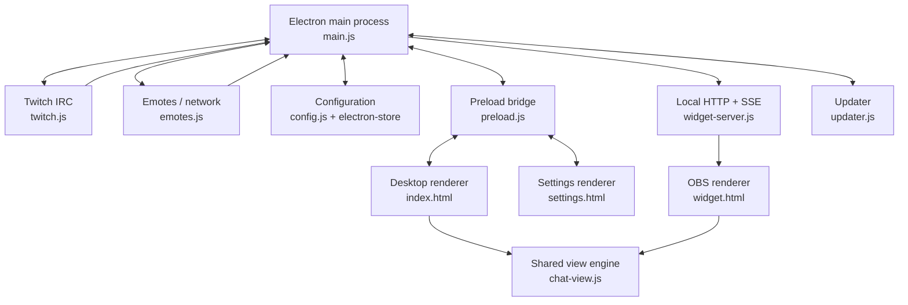
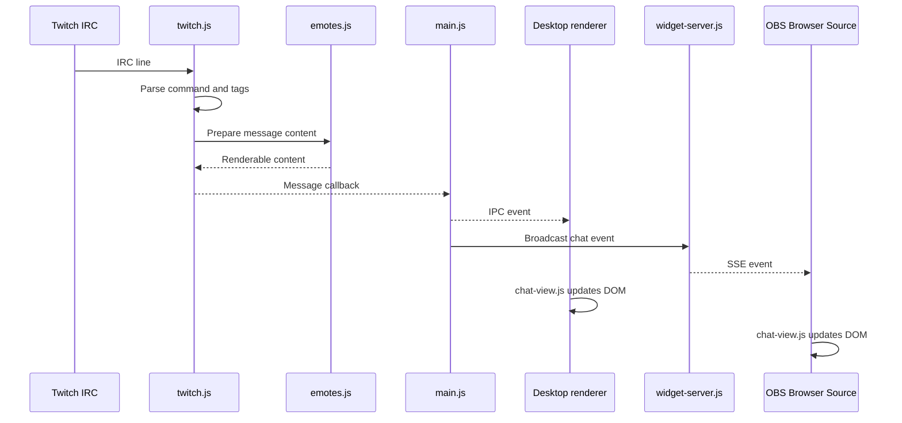

# Архитектура TwitchTransparentChat

## 1. Назначение и общая схема

TwitchTransparentChat — настольное приложение на Electron для отображения Twitch-чата в двух представлениях:

- **Desktop Overlay** — прозрачное окно Electron поверх других окон.
- **OBS Widget** — локальная веб-страница, которую OBS открывает как Browser Source.

Оба представления получают события от одного подключения к Twitch и используют общий модуль визуализации `chat-view.js`. OBS не подключается к Twitch самостоятельно: события передаются ему локальным HTTP-сервером через Server-Sent Events (SSE).

Главный процесс Electron (`main.js`) координирует окна, сетевые модули, конфигурацию и передачу событий.

## 2. Структура проекта

Основные файлы и каталоги корня репозитория:

| Путь | Назначение |
|---|---|
| `main.js` | Главный процесс Electron: жизненный цикл приложения, окна, tray, IPC, настройки и координация модулей |
| `preload.js` | Контролируемый API renderer-процессов через `contextBridge` и IPC |
| `twitch.js` | Подключение к Twitch IRC, разбор IRC-команд, сообщений и событий модерации |
| `emotes.js` | HTTP(S)-запросы, прокси, получение эмоций/бейджей и подготовка HTML текста |
| `config.js` | Значения по умолчанию, нормализация и проверка конфигурации |
| `chat-view.js` | Общий клиентский движок отображения сообщений |
| `index.html` | Renderer desktop-оверлея |
| `settings.html` | Интерфейс настроек, предпросмотров и управления параметрами |
| `widget-server.js` | Локальный HTTP-сервер и SSE-рассылка для OBS Widget |
| `widget.html` | Renderer OBS Widget |
| `chat.css` | Стили сообщений |
| `fonts.css` | Подключение локальных шрифтов |
| `locales.js` | Строки локализации |
| `updater.js` | Проверка и установка обновлений |
| `fonts/` | Локальные файлы шрифтов WOFF2 |
| `screenshots/` | Изображения, используемые документацией/README |
| `icon.ico` | Иконка приложения |
| `package.json` | Метаданные, зависимости, команды запуска и настройки сборки |

В корне также находятся `README.md`, `README.ru.md`, `.gitignore` и `LICENSE`.

## 3. Точки входа

- Electron запускает главный процесс из `main.js` (поле `main` в `package.json`).
- Desktop overlay создаётся главным процессом и загружает `index.html`.
- Окно настроек создаётся главным процессом и загружает `settings.html`.
- OBS Widget отдаётся локальным сервером из `widget-server.js`; его HTML-точка входа — `widget.html`.

## 4. Архитектурная схема

Схема показывает логические зависимости. В частности, `preload.js` предоставляет renderer API, а не является самостоятельным сервисом приложения.

## 5. Основные потоки данных

### 5.1. Получение и отображение сообщения

1. `twitch.js` получает данные из TLS-соединения с Twitch IRC.
2. Модуль разбирает IRC-команду и теги, формирует данные сообщения.
3. Для подготовки содержимого используются функции `emotes.js`.
4. Callback передаёт результат в `main.js`.
5. Главный процесс направляет событие desktop renderer через IPC и OBS-серверу через SSE.
6. Renderer передаёт данные в общий `chat-view.js`, который обновляет DOM.

### 5.2. События модерации

Twitch IRC сообщает об удалении отдельного сообщения через `CLEARMSG`, о блокировке/таймауте пользователя и очистке чата — через `CLEARCHAT`.

`twitch.js` преобразует их в события удаления, которые `main.js` передаёт обоим представлениям. В renderer общий движок находит соответствующие элементы и удаляет их. Таким образом, обработка удаления отделена от обычной доставки нового сообщения.

### 5.3. Конфигурация и сохранение настроек

Настройки редактируются в `settings.html`. Вызовы доступны через API из `preload.js`, IPC обрабатывается в `main.js`, а `config.js` нормализует входные данные перед сохранением в `electron-store`.

После сохранения главный процесс обновляет состояние overlay и OBS Widget. В конфигурации существуют общие параметры и отдельная секция оформления виджета.

### 5.4. Предпросмотр

Настройки содержат отдельные пути предпросмотра overlay и widget. Предпросмотр передаёт временные данные отображению; его не следует путать с сохранением постоянной конфигурации.

## 6. OBS Widget: HTTP и SSE

OBS использует локальный сервер приложения, а не прямое подключение к Twitch.

Подтверждённые маршруты сервера:

| Маршрут | Назначение |
|---|---|
| `/` | Страница виджета |
| `/api/state` | Текущее состояние/настройки |
| `/events` | SSE-поток событий |
| `/chat.css` | Стили чата |
| `/chat-view.js` | Общий движок отображения |
| `/fonts.css`, `/fonts/*` | Стили и файлы шрифтов |
| `/img/*` | Изображения эмоций и бейджей |
| `/card/*` | Пользовательские изображения плашек |

Сервер привязывается к loopback-адресу `127.0.0.1`, обслуживает GET/HEAD, проверяет Host и использует SSE heartbeat. При остановке сервера клиентские SSE-соединения закрываются.

## 7. Слои и ответственность

- **Интеграция с Twitch:** `twitch.js` отвечает за IRC-протокол и события.
- **Сетевые ресурсы чата:** `emotes.js` получает внешние данные и подготавливает HTML-содержимое.
- **Оркестрация и системная интеграция:** `main.js` связывает процессы и сервисы Electron.
- **Контракт renderer/main:** `preload.js` предоставляет ограниченный API.
- **Конфигурация:** `config.js` отвечает за допустимую форму настроек.
- **Представление:** `chat-view.js`, HTML и CSS отвечают за DOM и внешний вид.
- **OBS-транспорт:** `widget-server.js` предоставляет локальный HTTP/SSE интерфейс.

При изменении межмодульных данных важно учитывать обе ветви доставки: IPC для desktop и SSE для OBS.
