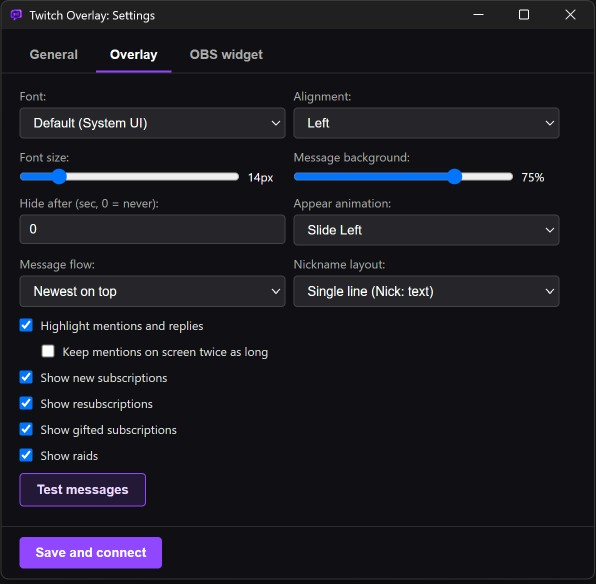
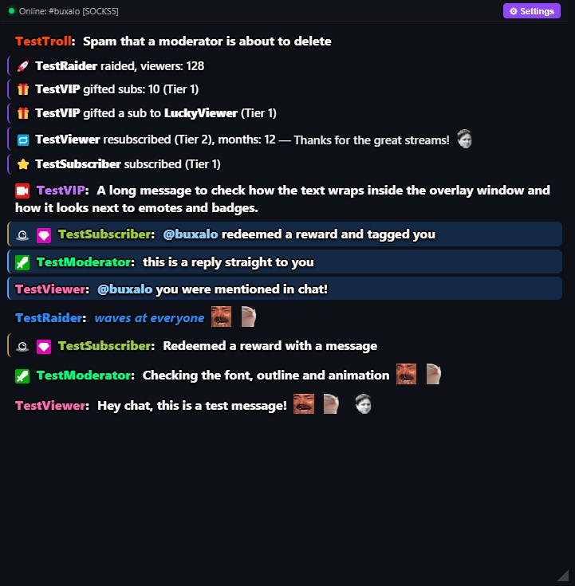

<p align="center">
  <b>English</b> | <a href="README.ru.md">Русский</a>
</p>

# Twitch Transparent Chat Overlay

A minimalist, lightweight and fully transparent Twitch chat overlay that sits on top of any window or game. No OAuth login needed: it connects over IRC/TLS as an anonymous `justinfan` user and barely touches your system resources while you stream.

<p align="center">
  
</p>

<p align="center">
  
</p>

## ⚠️ Important: game display mode

For the overlay to appear on top of a game, set the game to **Borderless Windowed** (or Borderless Fullscreen) in its graphics settings.

In classic **Exclusive Fullscreen** the GPU takes over the game output and bypasses the Windows compositor (DWM), so no regular transparent window can be drawn on top of it.

---

## Features

* **Full transparency and click-through mode**: the window stays on the `screen-saver` level above borderless windows. Press `Ctrl+Alt+F9` to enable click-through: the overlay stops catching the mouse, hides its title bar and doesn't get in the way of gameplay.
* **Readable in any scene**: a multi-direction text outline (`text-shadow`) keeps text crisp and contrasty even on bright game scenes.
* **Native emotes and badges**: official Twitch badges (Broadcaster, Mod, VIP, Sub, etc.) and emotes, positioned by Unicode code points so emojis never shift them.
* **7TV, BetterTTV and FrankerFaceZ emotes**: global and channel emotes (the channel ID comes from the `room-id` tag), animated and zero-width (overlay) emotes included. With SOCKS5 enabled, emotes and their images are loaded through the proxy; otherwise they load directly.
* **Mention and reply highlight** (can be switched off): messages that mention `@your_channel` and replies to your messages get a blue background, a blue side line, a short flash and a highlighted `@name`. Your nickname is taken from the channel you entered, so there is nothing extra to configure. A sub-option keeps highlighted mentions on screen twice as long.
* **Channel point reward highlight**: rewards with text input (`custom-reward-id`) get a thin golden side line and a points icon. A reward that also mentions you keeps the golden line and gets the blue background.
* **Moderation sync**: when a moderator deletes a message, or bans / times out a user, their messages disappear from the overlay at once. A cleared chat (`/clear`) clears the overlay too. This works out of the box, no setting required.
* **Optional chat event lines**: compact one-line notices for new subscriptions, resubscriptions, gifted subscriptions and raids. Each event type has its own checkbox and all of them are **off by default**. A mass gift is shown as a single line instead of one line per recipient.
* **Settings in a separate window** with three tabs: **General** (channel, language, proxy, filters, autostart), **Overlay** and **OBS widget**. The overlay window keeps its size, appearance changes are shown on the overlay live while you edit, and closing the window without saving restores the saved look.
* **OBS widget** (optional, off by default): the chat as a Browser source for OBS with its own size and appearance settings, a link copied in one click, its own test button and proxy support for emotes. See [OBS widget](#obs-widget-optional) below.
* **Test messages**: buttons in the settings play every scenario in a row (regular, moderator, reward, `/me`, mention, reply, reward + mention, long message, all event types, and a message that gets deleted by a "moderator") without connecting to a chat. The overlay and the OBS widget have separate test buttons, so nothing unexpected shows up on a live scene.
* **Stays put when you minimize windows**: the overlay has no taskbar button and isn't listed in Alt+Tab, so Win+D, "Show desktop", Win+M and the taskbar can't hide it. It is controlled from the tray icon and with `Ctrl+Alt+F9`.
* **Click-through button**: a **Click-through** button next to **Settings** in the window header switches to click-through mode in one click (you leave it with `Ctrl+Alt+F9` or from the tray menu).
* **Start with Windows**: an optional checkbox in settings, off by default.
* **One copy at a time**: launching the app again doesn't open a second overlay. The running one leaves click-through mode, appears and comes to the front.
* **Lost window rescue**: if the saved position is off every screen (for example, a monitor was unplugged), the overlay starts in the center of the main monitor. The saved position isn't overwritten until you move the window yourself, so it returns to its place when the monitor is back.
* **Tray icon**: a left or right click opens the menu: show/hide the overlay, toggle click-through, open settings, quit.
* **Two interface languages**: English (default) and Русский, switchable in settings without a restart.
* **Proper `/me` handling**: action messages (`\x01ACTION ...\x01`) are cleaned up, tinted with the author's color and never break emote positions.
* **Custom typography**: fonts (Inter, Montserrat, Roboto or system UI), font size, message background opacity and text alignment.
* **Memory-leak protection**: configurable message lifetime plus a hard cap of 150 messages in the DOM when the timer is off (`0 sec`), so long streams never drop FPS.
* **SOCKS5 support**: built-in client with username/password authentication for bypassing network blocks.
* **Chat filters**: hide commands (starting with `!`) and ignore bots and individual users with a configurable list (Nightbot, StreamElements, etc.). Entries are matched against the user's login as well as the display name, so non-Latin nicknames work too.
* **Reliable networking**: exponential backoff, a 60-second watchdog, handling of Twitch's scheduled `RECONNECT` and TLS/TCP timeouts. Connection status is shown by an indicator, never as messages in the chat.

---

## Controls

| Element | Action |
| :--- | :--- |
| **`Ctrl+Alt+F9`** | Toggle click-through game mode (mouse clicks pass through the chat into the game) |
| **Bottom-right corner** | Resize handle (visible in settings mode) |
| **"Click-through" button** | In the window header, left of Settings: switches to click-through mode |
| **"⚙ Settings" button** | Opens the settings window with the General, Overlay and OBS widget tabs |
| **"Test messages" buttons** | In the settings: one for the overlay (Overlay tab) and one for the widget (OBS widget tab) |
| **Tray icon** | Left or right click opens the menu: show/hide the overlay, click-through mode, settings, quit |

> If `Ctrl+Alt+F9` is already taken by another program, a yellow ⚠ appears next to the connection indicator.

---

## Good to know

* **Mentions follow the channel name.** The overlay assumes you watch your own chat, so the channel you enter is also the name it looks for in `@mentions` and replies. If you connect to someone else's channel, highlights are for that channel's owner.
* **Chat events come from the regular chat connection.** Subscriptions, gifts and raids are shown when Twitch sends them to the chat. Rewards without text and follows are not available without logging in, so they are not shown.
* **Messages held by AutoMod** are never delivered to an anonymous connection, so they never appear in the overlay in the first place.
* **No taskbar button.** The overlay isn't shown in the taskbar or in Alt+Tab. Use the tray icon (left or right click) to hide or show it, open settings or quit.
* **The OBS widget works only while the app is running.** The overlay window can be hidden, the widget keeps working. If you close the app, the Browser source goes empty and reconnects by itself when the app is started again.
* **The widget is available on this computer only.** The server accepts connections from `127.0.0.1` and refuses everything else, so OBS running on another computer can't use it.
* **Fonts.** Inter, Montserrat and Roboto are loaded from Google Fonts; if that site is blocked or there is no internet, a fallback font is used. The system font is taken from the computer where OBS runs.

---

## OBS widget (optional)

Besides the overlay on top of the game, the app can show the chat as a **widget for OBS**: it appears only on stream, not in front of you, and has its own size and appearance. It is **off by default**.

1. Open **Settings → OBS widget**, tick **Enable OBS widget** and press **Save and connect**. Change the port if `8769` is busy; the app tells you if it is.
2. Press **Copy link**.
3. In OBS add a **Browser** source, paste the link as the URL and set the width and height you need. The widget fills the whole source, so size and proportions are set in OBS.
4. Press **Test messages (widget only)** to see every scenario in OBS. It sends nothing to the overlay, and the overlay's own test sends nothing to OBS.

The widget has its own appearance settings (font, size, background, animation, direction, lifetime, chat events and mention highlight) and shares the channel, proxy, ignore list and command filter with the overlay. Mention highlight is **on** in the overlay and **off** in the widget by default.

Emotes blocked in your region keep working: with the SOCKS5 proxy enabled, the app downloads the images itself and passes them to OBS, so OBS never contacts those servers directly.

---

## Where settings are stored

Settings, window position and size persist between launches via `electron-store`:

* **Windows**: `%APPDATA%\TwitchOverlay\config.json`  
  *(full path: `C:\Users\<UserName>\AppData\Roaming\TwitchOverlay\config.json`)*
* **Linux**: `~/.config/TwitchOverlay/config.json`
* **macOS**: `~/Library/Application Support/TwitchOverlay/config.json`

> When running from source with `npm start`, the folder is named `twitch-overlay` instead of `TwitchOverlay`.

---

## Tech stack

* **Runtime**: Electron
* **Platform**: Node.js
* **Networking**: `tls`, `net`, `https`, `socks` (SOCKS5), Twitch IRC v3 tags parser, 7TV / BTTV / FFZ APIs, a local HTTP server with SSE for the OBS widget
* **Storage**: `electron-store`
* **Packaging**: `electron-builder` (Portable)

---

## Running from source

1. Clone the repository and open the project folder:
   ```bash
   git clone https://github.com/BuXaLo/TwitchTransparentChat.git
   cd TwitchTransparentChat
   ```

2. Install dependencies:
   ```bash
   npm install
   ```

3. Start the app:
   ```bash
   npm start
   ```

---

## Building the portable .exe

To build a standalone executable that doesn't require Node.js:

1. Run the build command:
   ```bash
   npm run dist
   ```

2. The result appears in the `dist/` folder:
   ```text
   dist/TwitchOverlay 1.2.0.exe
   ```

> **Note**: Without a paid code-signing certificate, Windows SmartScreen may show a blue warning on first launch. Click **"More info"** → **"Run anyway"**.

---

## License

[MIT](LICENSE)
