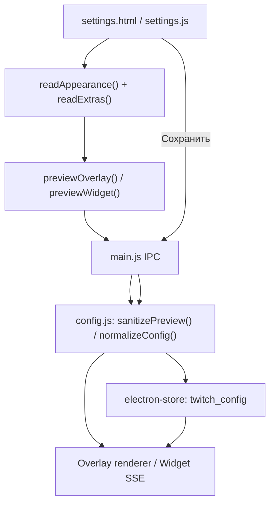

# Конфигурация и жизненный цикл настроек

Документ описывает фактический контракт конфигурации между интерфейсом настроек, главным процессом, хранилищем и двумя представлениями чата. Перед изменением полей сверяйтесь с `config.js`: именно он определяет допустимую структуру и нормализацию.

## 1. Где и как хранится конфигурация

Постоянное хранилище создаётся в `main.js` через `electron-store` с именем `config`. Основная конфигурация приложения хранится под ключом `twitch_config`. Язык интерфейса хранится отдельно под ключом `language`; границы окна — отдельно под `window_bounds`.

Физический каталог хранилища определяется стандартным `app.getPath('userData')` Electron. Portable-сборка не получает отдельную папку настроек только из-за своего типа: путь к данным не переопределяется.

Упрощённая структура `twitch_config`:

```text
twitch_config
├── общие параметры приложения
│   ├── channel, proxy*
│   ├── hideCommands, ignoredBots
│   ├── autoStart
│   ├── widgetEnabled, widgetPort
│   ├── ignoredUpdateVersion
│   └── customPresets[]
├── параметры оформления Overlay (верхний уровень)
│   ├── общие поля внешнего вида
│   ├── userStyles[]
│   └── rotation
└── widget
    ├── собственные поля внешнего вида
    ├── userStyles[]
    └── rotation
```

Верхнеуровневые поля оформления относятся к Desktop Overlay. Объект `widget` содержит отдельное оформление OBS Widget. Назначения стилей по никам и параметры ротации также независимы для двух представлений. Список пользовательских пресетов `customPresets` общий.

## 2. Нормализация и совместимость

`config.js::normalizeConfig()` — единственная штатная точка приведения полной конфигурации к допустимому виду. Она используется как при чтении из хранилища, так и при сохранении входящих настроек.

Нормализация:
- заполняет отсутствующие поля значениями по умолчанию;
- проверяет типы boolean и допустимые перечисления;
- ограничивает числовые значения заданными диапазонами;
- приводит цвета к HEX-формату;
- нормализует имя канала и порт виджета;
- фильтрует некорректные назначения пользовательских стилей и пулы ротации;
- создаёт `widget`, если его ещё нет, как копию нормализованного оформления Overlay с отключённой подсветкой упоминаний;
- принудительно оставляет `highlightMentions` и `mentionLonger` выключенными для Widget.

Важные ограничения из текущей реализации:

| Поле | Ограничение |
|---|---|
| Канал / ник Twitch | 1–25 символов, латиница в нижнем регистре, цифры и `_` |
| Порт Widget | 1024–65535, по умолчанию 8769 |
| Размер шрифта Overlay | 10–36 |
| Размер шрифта Widget | 10–72 |
| Время жизни сообщения | 0–300 секунд |
| Толщина рамки | 0–5 px |
| Скорость эффекта рамки | 1–10 |
| Назначения стилей по никам | до 200 на представление |
| Ручной пул ротации | до 5 стилей |
| Ротация «все стили» | до 200 стилей |

Для нового поля недостаточно добавить контрол в UI. Нужно определить default, нормализацию и диапазон в `config.js`, проверить представления Overlay/Widget, сохранение, предпросмотр и использование в renderer. При изменении структуры необходимо сохранить корректную загрузку старых конфигураций без нового поля.

## 3. Представления конфигурации для renderer

Главный процесс не должен без необходимости передавать renderer всё содержимое хранилища.

- `overlayView(cfg)` возвращает параметры оформления Overlay, назначения стилей по никам и пул ротации, а также общие фильтры `hideCommands` и `ignoredBots`.
- `widgetView(cfg)` возвращает самостоятельное оформление Widget, его назначения/ротацию и те же общие фильтры. Подсветка упоминаний принудительно выключена.
- `sanitizePreview(view, maxFontSize)` проверяет временный объект предпросмотра и формирует renderer-представление без записи в хранилище.

`styleExtrasView()` преобразует список назначений `userStyles[]` в карту `ник → appearance`, а ротацию — в список снимков оформления. Renderer чата получает уже подготовленные данные.

## 4. Пользовательские пресеты, назначения и ротация

- `customPresets` — общий каталог пользовательских стилей. Запись содержит имя, признак блокировки и объект `appearance`.
- `userStyles` внутри Overlay и Widget — независимые назначения «ник → стиль». В конфигурации сохраняются ключ/имя стиля и снимок оформления.
- `rotation` в каждом представлении хранит источник пула, признак включения, порядок и снимки оформления.
- В настройках `settings/presets.js::readExtras()` разрешает актуальные ссылки на пресеты и формирует данные для сохранения/предпросмотра.
- Заблокированные пресеты не участвуют в ротации. Для включения ротации нужно не менее двух доступных стилей; случайный порядок доступен от трёх.
- Если назначенный стиль удалён из каталога, сохранённый снимок оформления назначения остаётся доступен; UI позволяет сохранить его копию как отдельный пресет.

Не объединяйте эти данные в один общий объект для Overlay и Widget: раздельность является частью текущего поведения.

## 5. Путь изменения настройки



### Живой предпросмотр

Изменения формы и завершение работы модальных окон планируют предпросмотр соответствующей вкладки. Для Overlay используется `preview-overlay`, для Widget — `preview-widget`. Эти IPC-сообщения не записывают данные в `electron-store`.

Overlay получает `config-applied` напрямую через IPC. Widget получает обновлённый объект состояния событием SSE `state`. Предпросмотр проверяется через `sanitizePreview()` с отдельным пределом размера шрифта для каждого представления.

### Сохранение

`save-config` нормализует весь объект, сохраняет его в `twitch_config`, применяет автозапуск, отправляет Overlay обновлённое представление и запускает/останавливает Widget согласно `widgetEnabled`. Затем Widget получает сохранённое состояние через SSE.

Подключение Twitch не должно перезапускаться при каждом изменении оформления. `main.js` сравнивает ключ подключения (канал и параметры прокси) и перезапускает его при изменении этих параметров, при первом запуске либо при явном запросе принудительного переподключения.

При закрытии окна настроек без сохранения главный процесс повторно отправляет Overlay и Widget состояние из сохранённой конфигурации, отменяя временный предпросмотр.

## 6. Изображения пользовательских плашек

Изображения хранятся отдельно от JSON-конфигурации: `userData/card-images/<имя>.webp`. В конфигурации записывается только идентификатор изображения в `cardImageCustom`.

Renderer настроек читает изображение, ограничивает исходник и конвертирует его в WebP через canvas; главный процесс повторно проверяет размер готового файла (не более 5 MiB) и сохраняет его. Имя очищается и делается уникальным. Переименование и удаление обновляют ссылки в сохранённых пресетах и назначениях. Старые изображения мигрируют при запуске приложения.

Внутри Electron изображения доступны через `card://img/<имя>`; для Widget локальный сервер переписывает этот адрес в `/card/<имя>`.

## 7. Изменения, требующие особой осторожности

1. Не менять плоское расположение верхнеуровневого оформления Overlay и вложенного `widget` без явной миграции.
2. Не удалять нормализацию старых/неполных конфигураций.
3. Не смешивать общие параметры подключения/фильтрации с независимым оформлением двух представлений.
4. Не менять формат снимков `userStyles` и `rotation` без проверки сохранённых пользовательских данных.
5. Не сохранять live preview в store и не вызывать переподключение Twitch при обычном редактировании внешнего вида.
6. Не считать пользовательские изображения частью JSON-конфигурации: файлы и ссылки на них имеют отдельный жизненный цикл.

## 8. Основные точки кода

| Файл | Ответственность |
|---|---|
| `config.js` | Defaults, диапазоны, sanitize/normalize, представления Overlay/Widget/preview |
| `main.js` | Чтение/запись `twitch_config`, применение настроек, preview IPC, userData и файлы изображений |
| `settings/settings.js` | Состояние форм, сбор данных, preview/save, modal snapshot |
| `settings/presets.js` | Каталог пресетов, назначения по никам и ротация |
| `settings/images.js` | Импорт/конвертация и управление пользовательскими изображениями |
| `preload.js` | Контролируемый API renderer для вызова IPC |
| `chat-view.js` | Применение полученного представления к сообщениям |
